<p align="center">
  
</p>

<h1 align="center">Smart Holidays</h1>

<p align="center">
  A travel website, client booking portal, and admin workspace for Smart Holidays and Smart Muslim by Roystar Travel &amp; Tours.
</p>

<p align="center">
  
  
  
  
</p>

<p align="center">
  <a href="#screenshots">Screenshots</a> ·
  <a href="#features">Features</a> ·
  <a href="#local-development">Local development</a> ·
  <a href="#run-tests">Run tests</a>
</p>

<p align="center">
  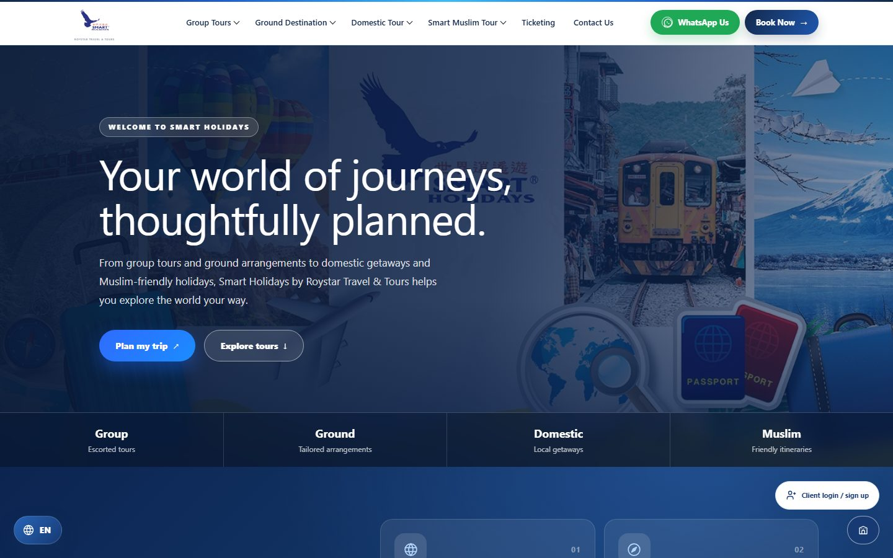
</p>

## Screenshots

> Client names, bookings, and revenue in these screenshots are demo data.

### Public website

<table>
  <tr>
    <td width="50%">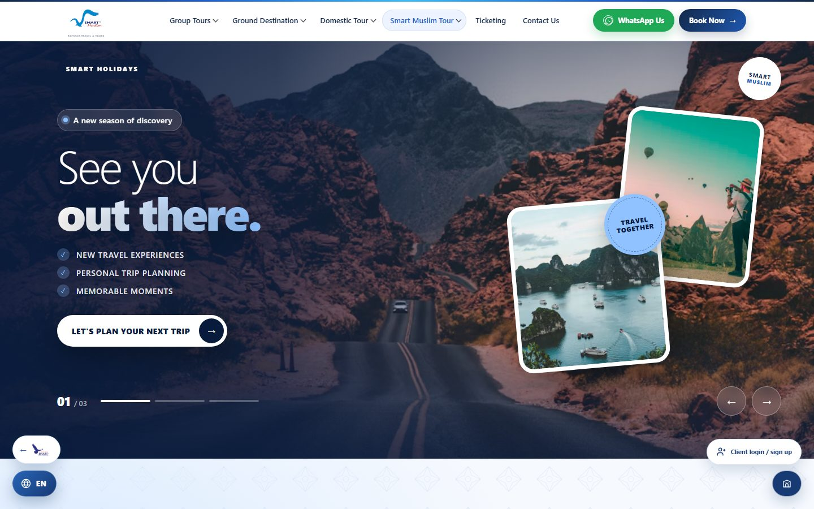</td>
    <td width="50%">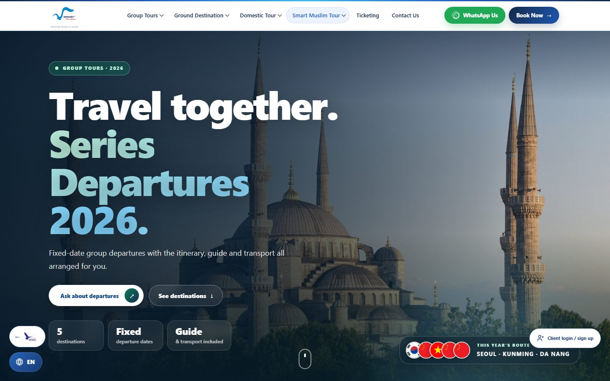</td>
  </tr>
  <tr>
    <td align="center"><b>Smart Muslim</b><br>Campaigns, services, and consultants</td>
    <td align="center"><b>Series departures</b><br>Fixed-date group tours</td>
  </tr>
  <tr>
    <td>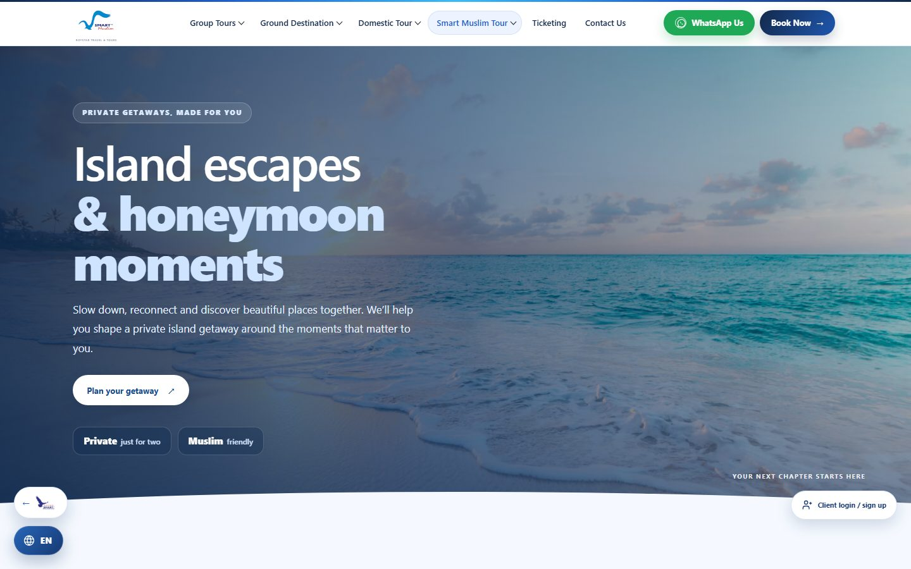</td>
    <td>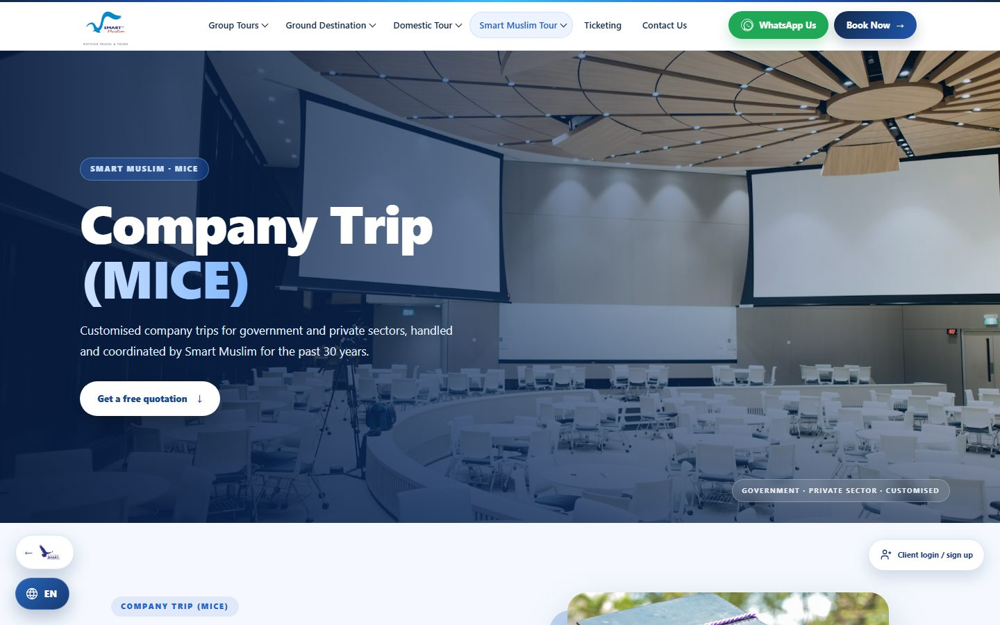</td>
  </tr>
  <tr>
    <td align="center"><b>Island &amp; Honeymoon</b><br>Private getaways</td>
    <td align="center"><b>Company Trip (MICE)</b><br>Corporate travel and quotations</td>
  </tr>
</table>

### Client portal

<table>
  <tr>
    <td width="50%">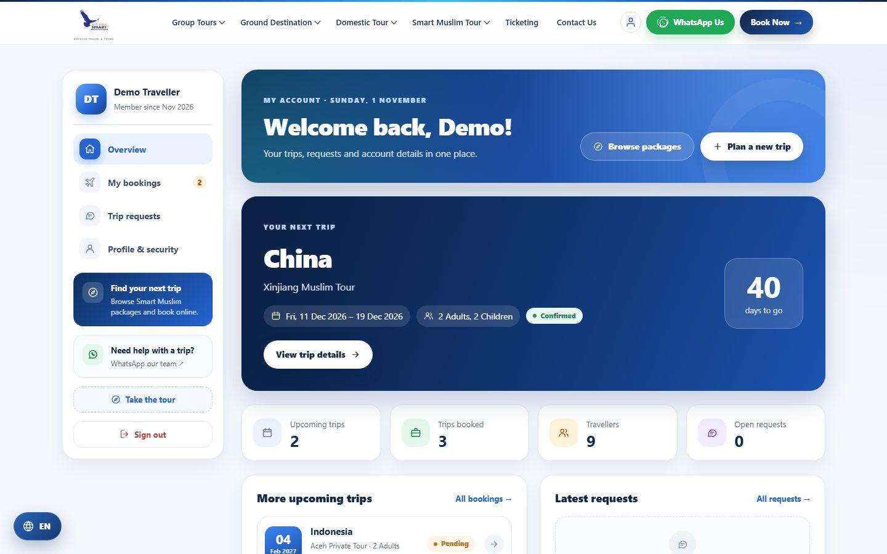</td>
    <td width="50%">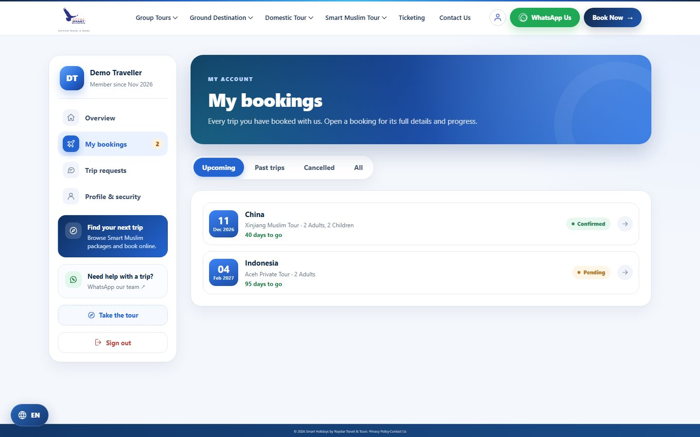</td>
  </tr>
  <tr>
    <td align="center"><b>Overview</b><br>Next trip, countdown, and account summary</td>
    <td align="center"><b>My bookings</b><br>Upcoming, past, and cancelled trips</td>
  </tr>
</table>

### Admin workspace

<table>
  <tr>
    <td width="50%">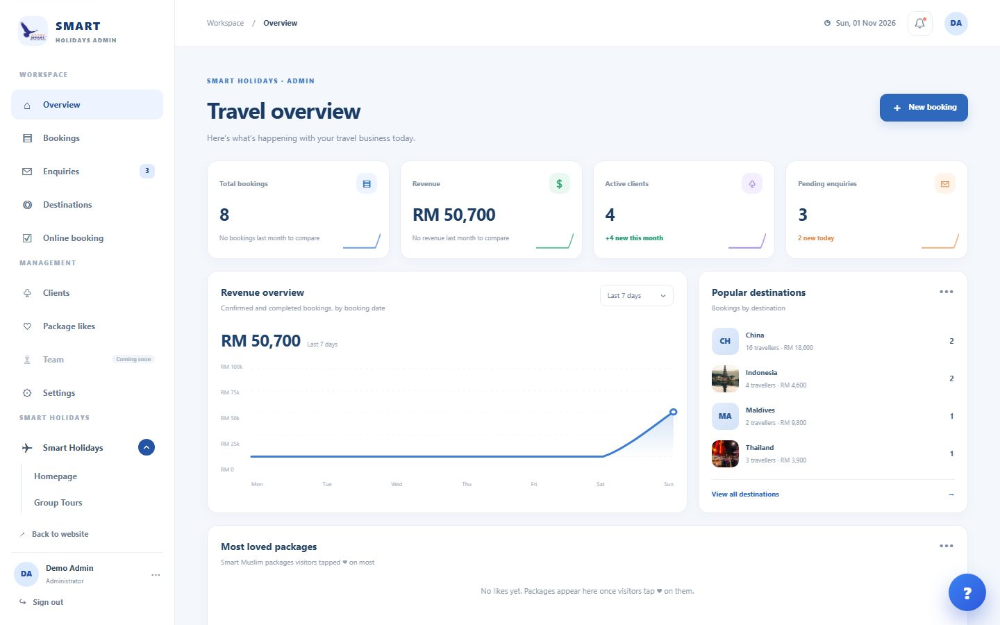</td>
    <td width="50%">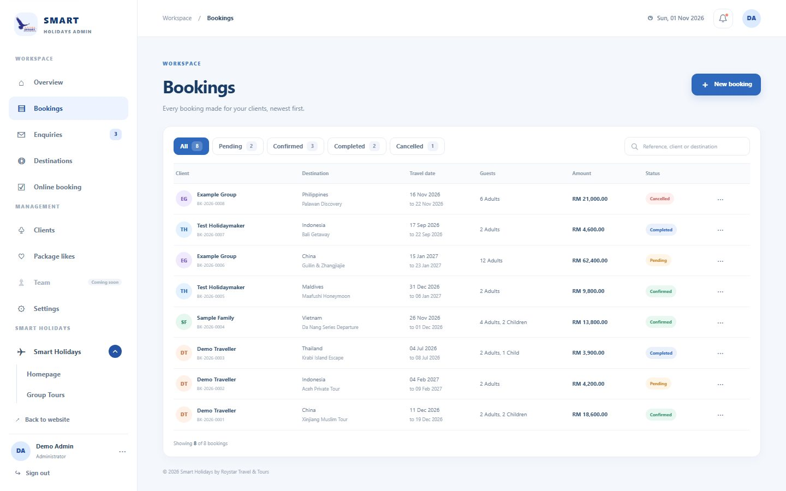</td>
  </tr>
  <tr>
    <td align="center"><b>Travel overview</b><br>Revenue, clients, and popular destinations</td>
    <td align="center"><b>Bookings</b><br>Search and filter by status</td>
  </tr>
  <tr>
    <td>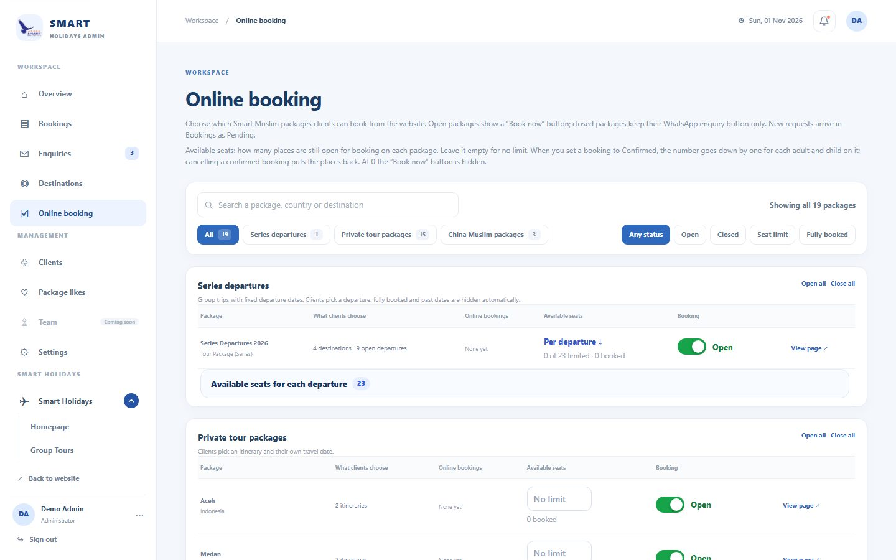</td>
    <td>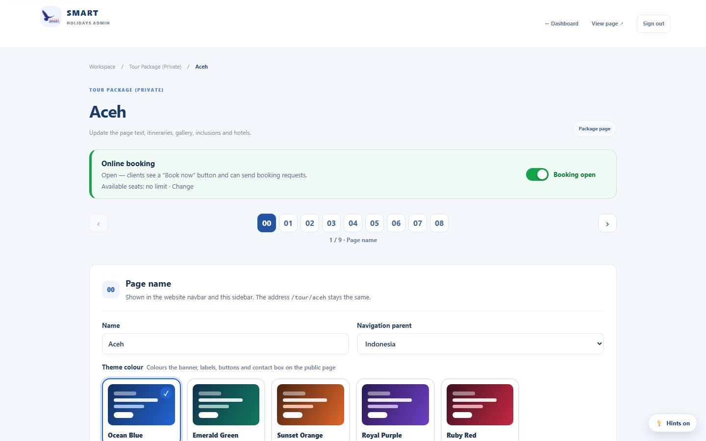</td>
  </tr>
  <tr>
    <td align="center"><b>Online booking</b><br>Open or close packages and set seat limits</td>
    <td align="center"><b>Package editor</b><br>Step-by-step page editing with colour themes</td>
  </tr>
</table>

### On mobile

<p align="center">
  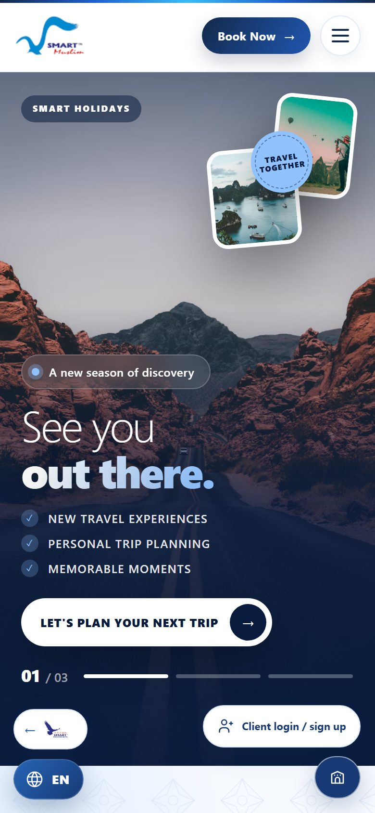
  &nbsp;&nbsp;
  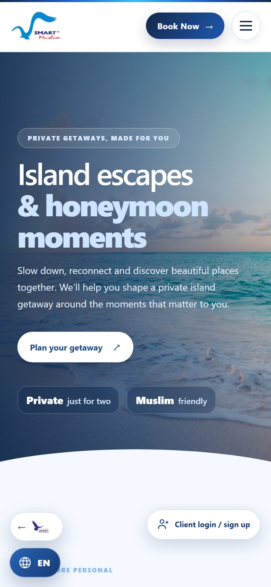
</p>

## Features

| Area | Highlights |
| --- | --- |
| 🌍 Public website | Group, ground, and domestic tours, Smart Muslim packages, China Muslim tours, Island & Honeymoon, MICE, ticketing, and gallery pages |
| 🗣️ Reaching customers | Enquiry forms, WhatsApp links, package likes, and English, Malay, and Chinese through Google Translate |
| 🧳 Client portal | Email-code sign-up and password reset, online package booking, trip requests, booking history, and a guided tour |
| 📊 Admin operations | Revenue overview, bookings, enquiries, client accounts and suspensions, package like stats, and light or dark themes |
| 🎟️ Seat management | Open or close each package, with seat limits per package or series departure; confirming a booking takes its seats and cancelling returns them |
| 🖼️ Content management | Edit homepage campaigns, services, consultants, destinations, tour packages, menus, and other site pages without changing code |

### Technology

- **Backend:** PHP 8.3+, Laravel 13
- **Frontend:** Blade, Vite, Tailwind CSS 4, and JavaScript
- **Database:** SQLite by default; connection settings can be changed in `.env`
- **Tests:** PHPUnit 12

### Where to find things

| Path | URL | Who it is for |
| --- | --- | --- |
| [`resources/views/SmartHolidays.blade.php`](resources/views/SmartHolidays.blade.php) | `/` | Visitors |
| [`resources/views/Smart-Muslim/`](resources/views/Smart-Muslim/) | `/smart-muslim` and its sections | Visitors |
| [`resources/views/client/`](resources/views/client/) | `/client/login`, `/my-account` | Clients |
| [`resources/views/Admin/`](resources/views/Admin/) | `/admin/login`, `/admin` | Administrators |
| [`routes/web.php`](routes/web.php) | All routes | Developers |

## Local development

### Requirements

- PHP 8.3 or later with the extensions required by Laravel
- Composer
- Node.js and npm

### Get started

1. Install project dependencies:

   ```sh
   composer install
   npm ci
   ```

2. Create your local environment file. Use `Copy-Item .env.example .env` in PowerShell, or `cp .env.example .env` on macOS/Linux.

3. In `.env`, set `APP_NAME`, `APP_URL`, and credentials for the admin account:

   ```dotenv
   ADMIN_NAME="Smart Holidays Admin"
   ADMIN_EMAIL=admin@example.com
   ADMIN_PASSWORD=use-a-unique-password-at-least-12-characters
   ```

   Keep `.env` private and never commit real credentials.

4. Generate the application key and create the default SQLite database file:

   ```sh
   php artisan key:generate
   php -r "file_exists('database/database.sqlite') || touch('database/database.sqlite');"
   ```

5. Run migrations and create the admin account:

   ```sh
   php artisan migrate
   php artisan db:seed --class="Database\Seeders\AdminUserSeeder"
   ```

   The migrations also add the starting site content, so the public pages work straight away.

6. Make uploaded images available and build the frontend assets:

   ```sh
   php artisan storage:link
   npm run build
   ```

7. Start the Laravel development server:

   ```sh
   php artisan serve
   ```

   Open the local URL printed by Artisan. The admin sign-in page is at `/admin/login`, and the client sign-in page is at `/client/login`.

For live frontend development, run `npm run dev` in a separate terminal.

> [!TIP]
> With the default `MAIL_MAILER=log`, sign-up and password reset codes are written to `storage/logs/laravel.log` instead of being emailed.

## Run tests

```sh
php artisan test
```

> [!WARNING]
> Tests reset the database they connect to. `phpunit.xml` selects an in-memory SQLite database, but any `DB_*` variables exported in your shell take priority over it. Check that none are set first, or your local database could be wiped.

## Handy commands

| Command | Purpose |
| --- | --- |
| `php artisan route:list` | List application routes |
| `php artisan migrate:status` | Check migration status |
| `npm run build` | Build production frontend assets |
| `vendor/bin/pint --dirty` | Format changed PHP files |

---

<p align="center">
  Made for memorable journeys.
</p>
